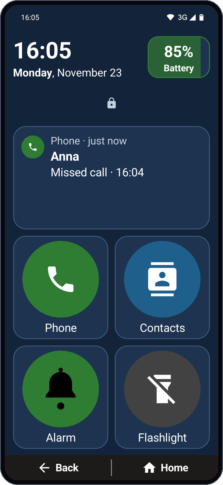
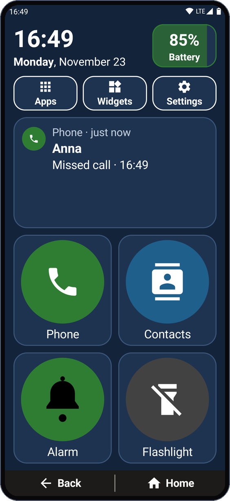
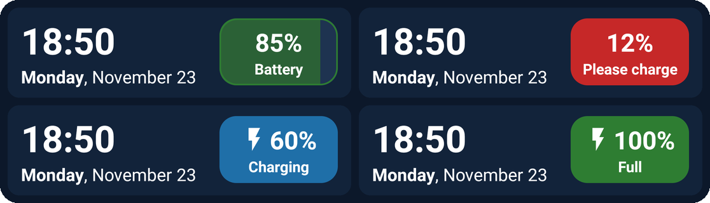
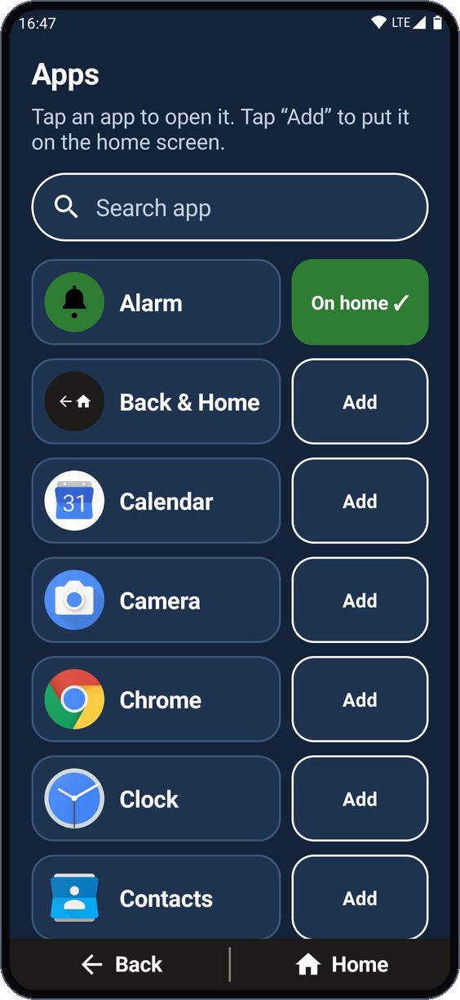
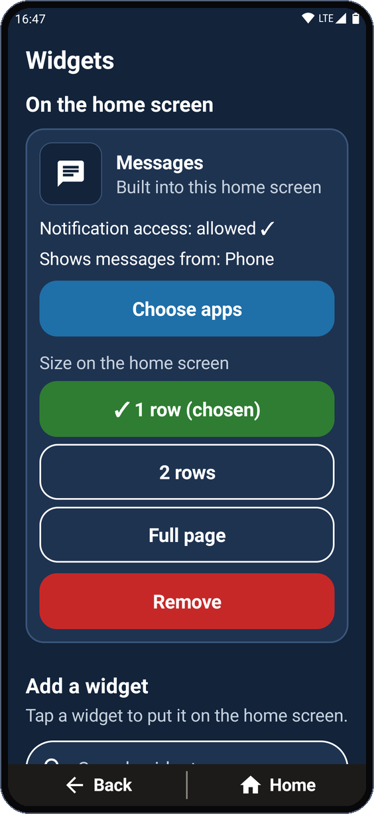
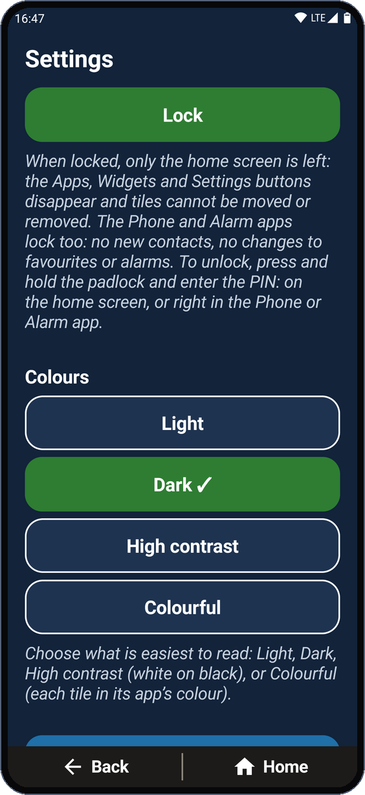

# SeniorLauncher

A very simple home screen for Android, made for seniors.

Big tiles open the apps you use. If there are more than fit, big **Next** and
**Previous** buttons turn the page; nothing scrolls and nothing moves on its
own. The top shows the time, the date and the battery, and says clearly
**Charging** when the phone is plugged in.

English and German. The app follows the phone's language.

[Deutsch weiter unten](#seniorlauncher-deutsch)

## What you see

  
  

- **Time and date** in large letters.
- **Battery** with the percent, in words:
  - green-bordered box that fills with light green as far as the charge goes,
    "Battery": on battery
  - red box, "Please charge": 20 % or less (the same size as the other boxes,
    so nothing else on the screen moves)
  - blue box with a lightning bolt, "Charging": plugged in and charging
  - green box with a lightning bolt, "Full": plugged in and full

  

- **Tiles**, two side by side, three rows per page. A tap opens the app.
- **Widgets** from other apps (a clock, the weather…) can sit between the
  tiles: small ones in a tile like an app, bigger ones across the full width.
- **Flashlight** (SeniorLight) appears as its live button: yellow when the
  light is on, grey when it is off; a tap switches it. Its app icon changes
  picture to show the same, which home screens do not always redraw in time,
  so the launcher uses the app's own button instead.
- **Messages** (if the helper adds it): a wide card with the newest
  messages from the apps the helper chose, each with the app, the sender, the
  text and when it came ("5 min ago"). A tap opens the message (or removes
  it, if the helper chose so). If not all
  fit, the card says how many more there are.
- **Page 1 of 3** with **Previous** and **Next**, only when there is more
  than one page. Pressing Home always goes back to page 1.

## Install

1. Download the latest `SeniorLauncher-*.apk` from the
   [Releases](https://github.com/SeniorPhoneKit/SeniorLauncher/releases) page on
   the phone.
2. Open it. Android asks whether to allow installing from this source; allow it
   once.
3. Open **Home**, tap **Settings**, then **Choose home app**, and pick **Home**.
   Until it is the home app, **How? Show the steps** below that button shows
   the way, also for other phones (Samsung: Apps, Choose default apps).

Needs Android 8.0 or newer.

## Setting it up (for the helper)

  
  
  

- **Apps** lists every app. **Add** puts it on the home screen, **On home ✓**
  takes it off again (after asking). New tiles go to the end.
- **Settings → Arrange home screen** shows the home screen as it looks. Tap a
  tile, then tap where it should go: on another tile (it takes that place) or
  on a free spot. **Previous** / **Next** reach the other pages, with the tile
  still picked. Tap it again to leave it where it is; **Remove** takes it off.
  Wide widgets and the messages card always take whole rows: dropped next to
  a tile they start the next row, or the next page if they do not fit.
- **Widgets** lists the widgets your apps offer. Tap one to put it on the home
  screen; Android asks once whether to allow it. Afterwards the home screen
  opens on the page with the new widget. Each placed widget can be made
  bigger or smaller there (**Small**, **1 row**, **2 rows**, **Full page**:
  only the sizes the widget supports; bigger means bigger text), and removed.
  A widget whose app turned it off or was uninstalled is hidden on the home
  screen and marked "no longer available" here.
- **Flashlight**: adding SeniorLight on **Apps** places its live button, not a
  plain tile. An older Flashlight tile is turned into the button in the same
  place: without a question if you once ticked Android's "Always allow",
  otherwise the home screen asks you once (never while locked). If you say
  no, it does not ask again; **Widgets** can still add the button.
- **Messages card**: in **Widgets**, tap **Messages** at the top of "Add a
  widget". Then, once:
  1. On the card, tap **Allow notification access**, turn on **Allow
     notification access** and tap **Allow**. (Android 13 and newer, for an
     APK from the Releases page: if the switch is greyed out, open *Settings →
     Apps → Home*, tap ⋮ and **Allow restricted settings**, then try again.)
     In **Widgets**, **How? Show the steps** under that button shows these
     steps on the phone, with a button to App info.
  2. Check **Choose apps** (in **Widgets**, on the Messages card): Phone,
     SMS, WhatsApp, Signal and Telegram are picked already if installed. Tap
     **Show** / **Shown ✓** to change it. Nothing else appears on the card.
  Size it there too (**1 row**, **2 rows**, **Full page**) and move it like
  a tile. **When a message is tapped**: **Open it**, **Open it and remove it**
  or **Remove it only** (ongoing ones are never removed). While locked, a card that is not set up is hidden.
  Privacy: the messages stay on the phone and are only kept in memory while
  shown; only the list of chosen apps is saved.
- **Settings → Colours**: Light, Dark, High contrast (white on black), or
  Colourful (each tile in its app's colour). Pick whatever is easiest to read.
- **Settings → App icons**: Round (every app icon a filled circle, the
  default) or As designed (each app's own shape).
- **Settings → Lock**: choose a PIN (4 to 8 digits). Afterwards only the
  tiles are left, so nothing can be changed by accident. To unlock, press and
  hold the padlock at the top and enter the PIN; the Phone and Alarm apps
  unlock with the same PIN. Forgotten PIN: the reset PIN **506614** opens
  every Senior app's lock. With the Back & Home bar app (SeniorNav) the
  helper can also record a pattern of volume-button presses that locks and
  unlocks; it locks with the last PIN, so a PIN has to be chosen here once.
- To move a tile or take it off, press and hold it (only when unlocked) and
  choose **Move** (Arrange opens with that tile picked) or **Remove**. Removing anything from the home screen (a
  tile, a widget, the messages card) always asks first.
- **Back** at the bottom of every helper screen goes straight back to the
  home screen in one tap, to the page it showed.
- **Settings → Backup** saves the settings to a file you choose (Downloads,
  Google Drive, …) and loads them back, after a reset or on a new phone.
  **Save settings to a file** keeps the home screen (tiles in order, sizes,
  the messages card, its apps and what a tap does), the colours and the icon style. **Save all Senior apps'
  settings** puts those of the Phone, Alarm and Back & Home apps in the same
  file (SeniorLight has no settings). Loading asks first and then replaces
  the current settings; it says what it could not restore: apps that are not
  installed are skipped and named, and widgets have to be added again by
  hand (Android asks for each), the list says which; the Flashlight button
  comes back by itself, as described above. The lock and its PIN
  are never saved; a load leaves this phone's lock as it is. Each Senior app
  can also save and load just its own settings; either kind of file loads
  either way.

## Automation (Trigly, Tasker, …)

Automation apps can lock, unlock, recolour the home screen, change its icons and what a tap on a message does with a
broadcast to package `app.phueber.seniorlauncher`. All extras are text.

| Send mode | Action | Extras | What it does |
|---|---|---|---|
| Broadcast | `app.phueber.seniorlauncher.action.LOCK` | `pin`: 4 to 8 digits | Locks the home screen (and the Phone and Alarm apps) with this PIN. Does nothing if it is already locked. |
| Broadcast | `app.phueber.seniorlauncher.action.UNLOCK` | `pin`: the PIN, or the reset PIN | Unlocks, if the PIN is right. |
| Broadcast | `app.phueber.seniorlauncher.action.SET_THEME` | `theme`: `light`, `dark`, `high_contrast` or `colourful` | Picks the colours, like Settings → Colours. |
| Broadcast | `app.phueber.seniorlauncher.action.SET_ICONS` | `style`: `round` or `designed` | Picks the icon style, like Settings → App icons. |
| Broadcast | `app.phueber.seniorlauncher.action.MESSAGES_TAP` | `action`: `open`, `open_remove` or `remove` | Picks what a tap on a message does, like Widgets → Messages. |

Spaces and upper/lower case do not matter; anything unreadable is ignored.
Example in Trigly, lock every night at 22:00: trigger *Time 22:00*, action
*Fire intent* with send mode *Broadcast*, action
`app.phueber.seniorlauncher.action.LOCK`, package `app.phueber.seniorlauncher`,
extra `pin` = `1234`.

The settings backup has no automation command: saving and loading go through
the file picker, where the helper chooses the file, and a load replaces
settings only after a question.

## SeniorLauncher (Deutsch)

Eine sehr einfache Startseite für Android, gemacht für Senioren.

Große Kacheln öffnen die Apps, die Sie benutzen. Passen nicht alle auf eine
Seite, blättern große Knöpfe **Weiter** und **Vorige** um; nichts scrollt und
nichts verschiebt sich von selbst. Oben stehen Uhrzeit, Datum und Akku, und
während das Telefon lädt, steht dort deutlich **Lädt**.

### Was Sie sehen

- **Uhrzeit und Datum** in großer Schrift.
- **Akku** mit Prozent, in Worten:
  - grün umrandetes Feld, das sich so weit hellgrün füllt, wie der Akku
    geladen ist, „Akku“: läuft mit Akku
  - rotes Feld, „Bitte aufladen“: 20 % oder weniger (so groß wie die anderen
    Felder, damit sich sonst nichts auf dem Bildschirm verschiebt)
  - blaues Feld mit Blitz, „Lädt“: am Ladegerät, lädt
  - grünes Feld mit Blitz, „Voll“: am Ladegerät, voll
- **Kacheln**, zwei nebeneinander, drei Reihen pro Seite. Ein Tipp öffnet die
  App.
- **Widgets** anderer Apps (eine Uhr, das Wetter …) können zwischen den Kacheln
  stehen: kleine in einer Kachel wie eine App, größere über die ganze Breite.
- **Taschenlampe** (SeniorLight) erscheint als ihr Schalter: gelb, wenn das
  Licht an ist, grau, wenn es aus ist; ein Tipp schaltet. Ihr App-Symbol zeigt
  dasselbe mit wechselndem Bild, das Startseiten nicht immer rechtzeitig neu
  zeichnen; deshalb nimmt die Startseite den Schalter der App selbst.
- **Nachrichten** (wenn der Helfer sie hinzufügt): eine breite Karte mit den
  neuesten Nachrichten der Apps, die der Helfer gewählt hat, jeweils mit App,
  Absender, Text und wann sie kam („vor 5 Min.“). Ein Tipp öffnet die
  Nachricht (oder entfernt sie, wenn der Helfer das so gewählt hat). Passen nicht alle hin, steht da, wie viele noch da sind.
- **Seite 1 von 3** mit **Vorige** und **Weiter**, nur wenn es mehr als eine
  Seite gibt. Die Home-Taste führt immer zu Seite 1 zurück.

### Installieren

1. Laden Sie auf dem Telefon die neueste `SeniorLauncher-*.apk` von der Seite
   [Releases](https://github.com/SeniorPhoneKit/SeniorLauncher/releases).
2. Öffnen Sie sie. Android fragt, ob aus dieser Quelle installiert werden darf;
   erlauben Sie es einmal.
3. Öffnen Sie **Startseite**, tippen Sie auf **Einstellungen**, dann auf
   **Startbildschirm wählen**, und wählen Sie **Startseite**. Solange sie
   noch nicht der Startbildschirm ist, zeigt **Wie? Schritte zeigen** unter
   dieser Taste den Weg, auch für andere Telefone (Samsung: Apps,
   Standard-Apps auswählen).

Benötigt Android 8.0 oder neuer.

### Einrichten (für Helfer)

- **Apps** zeigt alle Apps. **Hinzufügen** legt sie auf die Startseite,
  **Auf Start ✓** nimmt sie (nach einer Rückfrage) wieder herunter. Neue Kacheln kommen ans Ende.
- **Einstellungen → Startseite ordnen** zeigt die Startseite, wie sie
  aussieht. Tippen Sie auf eine Kachel, dann auf ihren neuen Platz: auf eine
  andere Kachel (sie nimmt deren Platz ein) oder auf einen freien Platz.
  **Vorige** / **Weiter** führen zu den anderen Seiten, die Kachel bleibt
  ausgewählt. Nochmals antippen lässt sie, wo sie ist; **Entfernen** nimmt sie
  herunter. Breite Widgets und die Nachrichten-Karte nehmen immer ganze
  Reihen ein: Neben einer Kachel abgelegt, beginnen sie die nächste Reihe,
  oder die nächste Seite, wenn sie nicht mehr passen.
- **Widgets** zeigt die Widgets Ihrer Apps. Tippen Sie eines an, um es auf die
  Startseite zu legen; Android fragt einmal, ob das erlaubt ist. Danach öffnet
  die Startseite die Seite mit dem neuen Widget. Dort lässt sich jedes
  platzierte Widget auch größer oder kleiner machen (**Klein**, **1 Zeile**,
  **2 Zeilen**, **Ganze Seite**: nur die Größen, die das Widget kann; größer
  heißt größere Schrift) und entfernen. Ein Widget, das seine App abgeschaltet
  hat oder dessen App deinstalliert wurde, ist auf der Startseite ausgeblendet
  und hier als „nicht mehr verfügbar“ markiert.
- **Taschenlampe**: Unter **Apps** hinzugefügt, kommt SeniorLight als
  Schalter auf die Startseite, nicht als einfache Kachel. Eine ältere
  Taschenlampen-Kachel wird am selben Platz zum Schalter: ohne Rückfrage, wenn
  Sie bei Android einmal „Immer erlauben“ angehakt haben, sonst fragt die
  Startseite Sie einmal (nie, solange sie gesperrt ist). Sagen Sie nein, fragt
  sie nicht wieder; unter **Widgets** lässt sich der Schalter trotzdem
  hinzufügen.
- **Nachrichten-Karte**: unter **Widgets** oben bei „Widget hinzufügen“ auf
  **Nachrichten** tippen. Dann einmalig:
  1. Auf der Karte **Benachrichtigungszugriff erlauben** tippen,
     **Benachrichtigungszugriff erlauben** einschalten und **Zulassen**
     tippen. (Ab Android 13, bei einer APK von der Releases-Seite: Ist der
     Schalter grau, unter *Einstellungen → Apps → Startseite* auf ⋮ und
     **Eingeschränkte Einstellungen zulassen** tippen und es erneut
     versuchen.) Unter **Widgets** zeigt **Wie? Schritte zeigen** unter
     dieser Taste die Schritte auf dem Telefon, mit einer Taste zur App-Info.
  2. **Apps wählen** prüfen (unter **Widgets**, auf der Nachrichten-Karte):
     Telefon, SMS, WhatsApp, Signal und Telegram sind schon gewählt, falls
     installiert. **Zeigen** / **Gezeigt ✓** ändert das. Andere Apps
     erscheinen nicht.
  Dort lässt sich auch die Größe wählen (**1 Zeile**, **2 Zeilen**,
  **Ganze Seite**); verschoben wird sie wie eine Kachel. **Wenn eine Nachricht
  angetippt wird**: **Öffnen**, **Öffnen und entfernen** oder **Nur entfernen**
  (laufende werden nie entfernt). Gesperrt ist eine
  nicht eingerichtete Karte ausgeblendet.
  Datenschutz: Die Nachrichten bleiben auf dem Telefon und werden nur im
  Arbeitsspeicher gehalten, solange sie angezeigt werden; gespeichert wird
  nur die Liste der gewählten Apps.
- **Einstellungen → Farben**: Hell, Dunkel, Hoher Kontrast (weiß auf schwarz)
  oder Bunt (jede Kachel in der Farbe ihrer App). Wählen Sie, was am besten zu lesen
  ist.
- **Einstellungen → App-Symbole**: Rund (jedes App-Symbol ein gefüllter
  Kreis, die Voreinstellung) oder Original (die eigene Form jeder App).
- **Einstellungen → Sperren**: eine PIN wählen (4 bis 8 Ziffern). Danach sind
  nur noch die Kacheln da, sodass nichts aus Versehen geändert wird. Zum
  Entsperren das Schloss oben gedrückt halten und die PIN eingeben; die
  Telefon- und die Wecker-App entsperren mit derselben PIN. PIN vergessen:
  die Reset-PIN **506614** öffnet die Sperre jeder Senior-App. Mit der App
  für die Zurück-/Start-Leiste (SeniorNav) lässt sich zusätzlich ein Muster
  aus Lautstärketasten-Drücken aufnehmen, das sperrt und entsperrt; es sperrt
  mit der letzten PIN, deshalb muss hier einmal eine PIN gewählt worden sein.
- Um eine Kachel zu verschieben oder herunterzunehmen, halten Sie sie gedrückt
  (nur entsperrt) und wählen **Verschieben** („Startseite ordnen“ öffnet sich
  mit dieser Kachel ausgewählt) oder **Entfernen**. Bevor etwas
  von der Startseite entfernt wird (Kachel, Widget, Nachrichten-Karte), kommt
  immer eine Rückfrage.
- **Zurück** unten auf jeder Seite für Helfer führt mit einem Tipp direkt
  zur Startseite, auf die Seite, die sie zeigte.
- **Einstellungen → Sicherung** speichert die Einstellungen in eine Datei, die
  Sie wählen (Downloads, Google Drive, …), und lädt sie wieder, nach einem
  Zurücksetzen oder auf einem neuen Telefon. **Einstellungen in eine Datei
  speichern** bewahrt die Startseite (Kacheln in ihrer Reihenfolge, Größen,
  die Nachrichten-Karte, ihre Apps und was ein Tipp tut), die Farben und die App-Symbole auf. **Einstellungen
  aller Senior-Apps speichern** legt die der Telefon-, Wecker- und
  Zurück-/Start-App mit in dieselbe Datei (SeniorLight hat keine
  Einstellungen). Laden fragt zuerst und ersetzt dann die aktuellen
  Einstellungen; es sagt, was es nicht wiederherstellen konnte: Nicht
  installierte Apps werden übersprungen und genannt, und Widgets müssen von
  Hand wieder hinzugefügt werden (Android fragt bei jedem), die Liste sagt,
  welche; der Taschenlampen-Schalter kommt wie oben beschrieben von selbst
  zurück. Die Sperre und ihre PIN werden nie gespeichert; Laden lässt die
  Sperre dieses Telefons, wie sie ist. Jede Senior-App kann auch nur ihre
  eigenen Einstellungen speichern und laden; beide Arten von Datei lassen
  sich auf beiden Wegen laden.

### Automatisierung (Trigly, Tasker, …)

Automatisierungs-Apps können die Startseite per Broadcast an das Paket
`app.phueber.seniorlauncher` sperren, entsperren, umfärben, ihre App-Symbole ändern und festlegen, was ein Tipp auf eine Nachricht tut. Alle Extras sind
Text.

| Sendeart | Aktion | Extras | Was passiert |
|---|---|---|---|
| Broadcast | `app.phueber.seniorlauncher.action.LOCK` | `pin`: 4 bis 8 Ziffern | Sperrt die Startseite (und die Telefon- und Wecker-App) mit dieser PIN. Ist sie schon gesperrt, passiert nichts. |
| Broadcast | `app.phueber.seniorlauncher.action.UNLOCK` | `pin`: die PIN oder die Reset-PIN | Entsperrt, wenn die PIN stimmt. |
| Broadcast | `app.phueber.seniorlauncher.action.SET_THEME` | `theme`: `light`, `dark`, `high_contrast` oder `colourful` (auch `hell`, `dunkel`, `kontrast`, `bunt`) | Wählt die Farben wie Einstellungen → Farben. |
| Broadcast | `app.phueber.seniorlauncher.action.SET_ICONS` | `style`: `round` oder `designed` (auch `rund`, `original`) | Wählt die App-Symbole wie Einstellungen → App-Symbole. |
| Broadcast | `app.phueber.seniorlauncher.action.MESSAGES_TAP` | `action`: `open`, `open_remove` oder `remove` (auch `öffnen`, `entfernen`) | Wählt, was ein Tipp auf eine Nachricht tut, wie Widgets → Nachrichten. |

Leerzeichen und Groß-/Kleinschreibung sind egal; Unlesbares wird ignoriert.
Beispiel in Trigly, jeden Abend um 22:00 sperren: Auslöser *Zeit 22:00*,
Aktion *Intent senden* mit Sendeart *Broadcast*, Aktion
`app.phueber.seniorlauncher.action.LOCK`, Paket `app.phueber.seniorlauncher`,
Extra `pin` = `1234`.

Für die Sicherung der Einstellungen gibt es keinen Befehl: Speichern und
Laden laufen über die Dateiauswahl, in der Helfer die Datei wählen, und
Laden ersetzt Einstellungen erst nach einer Rückfrage.

## Contributing

See [CONTRIBUTING.md](CONTRIBUTING.md) and [ARCHITECTURE.md](ARCHITECTURE.md).
Licensed under the [Apache License 2.0](LICENSE).
