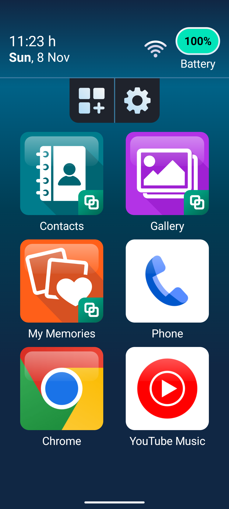
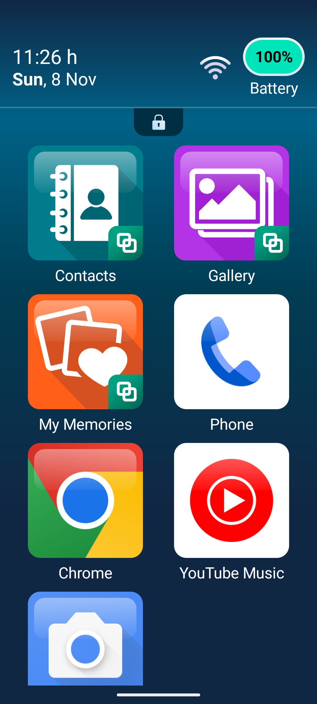
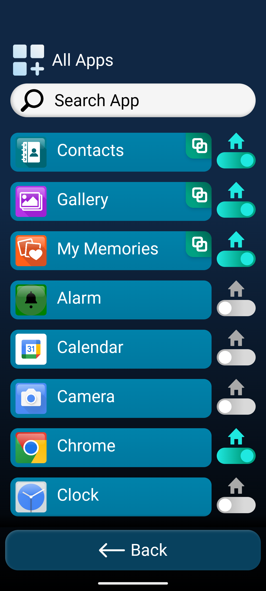
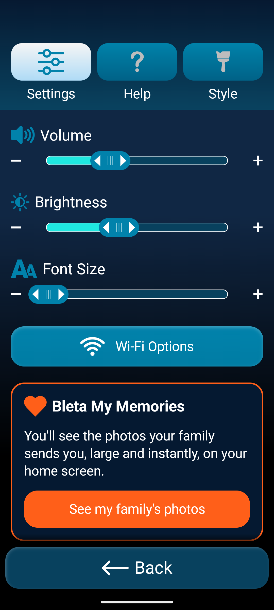
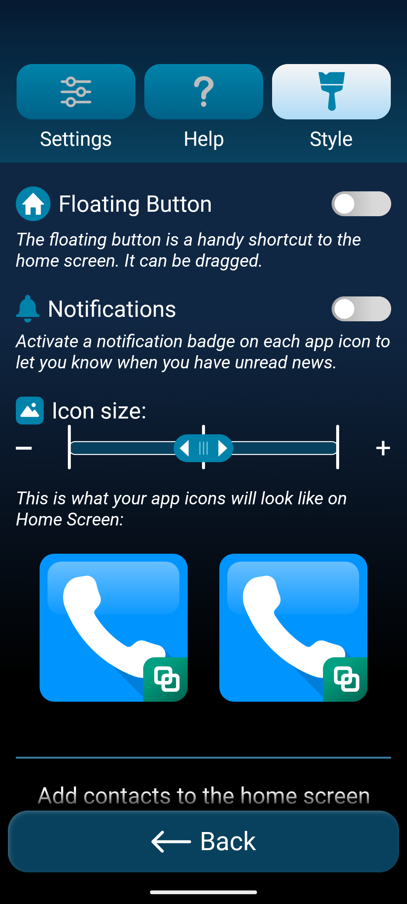

# Bleta: how it works and how it looks

Notes from trying Bleta 3.24.4 (`io.bleta.simplelauncher`, Play build) on the
Android 15 emulator (`senioralert-35`, 1080x2400, 420 dpi) on 2026-11-08. The
setup used the path "I'm setting it up for someone else". Screenshots are in
this folder.

These notes describe only what I saw on screen, not Bleta's code. They are a
reference for SeniorLauncher, not a spec.

## The core idea

Bleta replaces the home screen. The senior sees **one screen**: a large status
header and below it a **2-column grid of big tiles**. Everything else is either:

- a **helper area**, reached through two small buttons (all apps, settings) that
  can be **locked away** completely, or
- **Bleta's own simplified apps** (Contacts, Gallery, My Memories), which open
  inside the launcher and look the same as the home screen. Other apps (Phone,
  Chrome, Camera...) open as the normal Android app.

The setup assumes a helper: it asks "who will use this phone?", takes the
senior's name ("Anna's phone is now easier to use"), and the helper builds the
home screen and locks it.

## Home screen

 

- **Status header, always visible, not scrolling:** time as `11:23 h`, date as
  `Sun, 8 Nov` (weekday bold) on the left; Wi-Fi icon and a **battery pill**
  (`100%`, green fill) with the word "Battery" under it on the right. Words next
  to the icons, not just icons. The fill goes down with the charge and turns
  **red** when low (12 %). While **charging**, the "%" is replaced by a small
  **lightning bolt** ("⚡35"); the label still says "Battery" and nothing else
  changes, which is easy to miss
  ([12-battery-states.png](12-battery-states.png): normal, charging, low).
- **Helper bar** under the header: two square dark buttons joined in one pill,
  "all apps" (grid with +) and "settings" (gear). It stays pinned on top while
  the grid scrolls underneath. When settings are locked it shrinks to a small
  **padlock**.
- **Grid:** 2 columns. Each tile is a large rounded-square icon (~390 px at
  1080 px width, so about 36 % of the screen width) with the label underneath in
  large text. About 3 rows fit; with more tiles the grid **scrolls
  vertically**. There are no pages, no horizontal swipe, no dock and no
  app drawer gesture.
- **Order:** the defaults come first (Contacts, Gallery, My Memories, Phone,
  Chrome, YouTube Music). A newly added tile goes **at the end**. I found no way
  to reorder tiles: long-press does not start a drag.
- **Tap = open.** No double tap and no swipe on tiles.
- **Long-press on a tile (unlocked)** opens a dialog: "Remove from Home
  Screen?" with **Remove** (with an ✕) and **Cancel**, both full-width buttons.
  ([06-remove-tile.png](06-remove-tile.png)). When locked, long-press does
  nothing.
- **Bleta's own apps** have a small green Bleta badge in the bottom-right
  corner of the icon. Other apps get their own icon, scaled to the same tile
  size; Bleta draws its own versions for some (Chrome, Camera), with a glossy
  top highlight.
- **Contact tiles:** a contact can be put on home. It shows as a **round** tile
  with a big initial (or photo) and the **first name** only ("Maria"). A tap
  opens a **confirmation**, not a call: big initial, full name, a green
  **Call** button and a blue **Cancel** button
  ([11-call-confirm.png](11-call-confirm.png)).
- The system navigation (gesture bar) stays. In Style settings you can turn on a
  draggable floating **Home button** that shows over other apps.

## Locking (the helper's tool)

- Settings → "Lock settings". The explanation says: "When you lock settings,
  you will only have access to the Home Screen" and "You can unlock … by holding
  down the padlock".
- To lock, you **press and hold** a Lock button. A plain tap is not enough.
- When locked, the apps and settings buttons are replaced by a small padlock. A
  **short tap does nothing**. A **long press (~3 s)** asks "Do you want to
  unblock settings?" with **Unblock** / **Cancel**. There is no PIN.
- When locked, long-pressing a tile does not offer to remove it. The senior can
  only open things.

## All Apps = adding to home

- Title "All Apps" with the same grid-plus icon, then a big rounded **"Search
  App"** field.
- One app per row: a wide blue rounded **bar** with icon and name, and on the
  right a **home toggle** (a house icon above a switch). Teal = on the home
  screen, grey = not. Bleta's own apps have the badge on the bar.
- A tap on the toggle adds the app to home (at the end) or removes it. Tapping
  the bar opens the app. **This list is the only place to add to home**, and it
  is the same list the helper uses to find apps.
- Sorting: Bleta apps first, then alphabetical.

## Settings (three tabs)

 

The top has three big tab buttons with icon and label: **Settings**, **Help**,
**Style**. The selected tab is light, the others blue. At the bottom of every
screen there is a full-width **← Back** button.

- **Settings:**
  - **Volume**, **Brightness**, **Font Size**: one big slider each, with **−**
    and **+** buttons at the ends and an icon and word above.
  - Then a **Wi-Fi Options** button, an advertisement card for "Bleta My
    Memories" (orange), switches for "Important Notices" and **"Lock
    settings"**, and **"Advanced Options"**, which opens the normal Android
    Settings.
- **Help:** "Give my opinion" (feedback), **"Choose home screen"** (back to the
  normal launcher), and the privacy policy.
- **Style:** "Floating Button" switch, "Notifications" switch (badges on tiles),
  **"Icon size"** with 3 steps and a **live preview** of two tiles below it, and
  **"Home Screen Contact"** for putting contacts on home.
- Each option has an icon, a bold-ish title and a **one-sentence explanation in
  italics** under it that says what it is good for.

## Bleta's own apps

- **Contacts:** a search field at the top, a list with a star (favourite) on
  the left and the name as a wide button; **"New contact"** at the bottom left
  and **Back** at the bottom. The first time it opens, a tip explains favourites
  ("Tap the star… they will always appear first"). A contact page has a **top
  bar with three equal buttons: Back · Edit · Delete** (Delete in red). Below
  that: a big round photo/placeholder, the name, a full-width **Call** button,
  the number in large text, and an "Add contact to main screen" home toggle
  ([10-contact.png](10-contact.png)).
- **Gallery:** three full-width buttons on top ("Camera Gallery", "WhatsApp
  Gallery", "All Media"), then a **2-column grid of large thumbnails**, and Back
  at the bottom. A single photo has the same top bar: **Back · Send · Delete**,
  with Previous/Next arrows below.
- **Phone:** the tile opens the stock Google dialer. Bleta adds nothing here
  except the contact tiles' call confirmation.

## Setup flow

1. A splash screen with four app icons, then **"Hello! / Welcome to Bleta / Your
   phone will be easier to use"** and one **Enter** button.
2. **"Who will use this phone?"**: "I'm setting it up for someone else" / "I'll
   use it myself".
3. The senior's **name**, then **year of birth and gender** (with "Prefer not to
   say").
4. **Permissions, one per screen, "Permission 1 of 4"** with a progress bar:
   modify system settings (brightness, font size), Do-Not-Disturb access
   (volume), photos ("tap Allow and then Allow all"), contacts. The screens for
   permissions that open a system Settings page show a **looping video of the
   exact system screen** with "Step 1 – Select Allow". Each screen has **Later**
   and **Allow**. The phone-call permission is not asked here; it is asked the
   first time a call is made.
5. Location ("personalised recommendations"), then a **data-collection consent
   that has only an Accept button** (anonymous data including the list of
   installed apps).
6. **Make it the home screen:** an explanation with a step-by-step picture,
   then the system "Default home app" chooser, then "Success! … if you change
   your mind: Options → Help → Choose home screen".
7. **"All set! Anna's phone is now easier to use"**, Enter.

## Visual language

- **Dark background:** dark navy/petrol, `#0D2F4D`–`#102744` on the home
  screen; the setup screens use a gradient from navy at the top to petrol
  blue at the bottom. White text everywhere.
- **Colours with a job** (sampled from the screenshots): **teal-green
  `#00A182`** for the primary or positive action (Enter, Allow, Call),
  **petrol blue `#0182AB`** for secondary or neutral
  actions (Later, Cancel, list bars, tabs), **red** only for Delete, **orange**
  only for the My Memories advertisement. Switches are bright teal when on and
  grey when off.
- **Buttons:** full width or half width, about 150 px high (≈ 57 dp), corner
  radius ≈ 24 dp, centred text of ≈ 24 sp, often with an icon in front (← Back,
  ✕ Remove, phone Call). No text-only links except "Later", "Prefer not to say"
  and the privacy policy.
- **Two buttons:** side by side as **Later | Allow** (positive on the right), or
  stacked as **Call / Cancel** (positive on top).
- **Dialogs:** a centred dark card with a thin light-blue border over the
  dimmed home screen, a question as the title, and stacked full-width buttons.
- **Text:** Roboto, large (labels ≈ 24 sp, titles ≈ 30 sp). Explanations are
  short whole sentences; option explanations are italic.
- **Every icon has a word with it.** No buttons are icon-only, except the
  apps/settings pair and the padlock, which are for the helper.
- **Back is always a big button at the bottom** (or top left in detail views),
  not only the system back gesture.

## What I would take, and what not

**Decided (2026-11-08):** SeniorLauncher only launches. Phone and contacts,
including Bleta-style contact tiles with a call confirmation, belong in a
separate Senior app, not in the launcher. Unlike Bleta (which has no
widgets), the launcher can also host other apps' home-screen widgets.

**Take:**
- One scrolling 2-column grid of big tiles, a fixed status header with time,
  date and battery in words, and nothing hidden behind gestures.
- A helper area that can be locked so only the home screen is left, unlocked by
  a long press.
- The all-apps list with a home toggle per app as the only way to add tiles.
- Contact tiles that ask "Call Maria?" before they dial.
- One permission per screen, with a picture of the system screen the helper is
  about to see.
- Primary = green, secondary = blue, delete = red; Back always as a big button;
  one sentence under every setting.

**Leave out** (does not fit our ground rules):
- Account-like profiling (year of birth, gender), location, a forced data
  consent, the My Memories advertisement and the feedback prompts.
- Its own Gallery and Contacts apps. These are big features; we use the
  system apps, apart from contact tiles maybe.
- Badges, the floating button and icon-size settings, unless they turn out to
  be really needed.

**Open questions for us:**
- Reordering tiles: Bleta has none (new tiles go at the end). Do we need it?
- No PIN on the unlock, only a long press. That is enough for a senior, and
  SeniorAlert uses a long press too, but SeniorAlert also has a PIN.
- Translations in the tested build were incomplete (some setup screens were in
  Spanish). This happened because I installed only some of the APK's language
  parts; it says nothing about the app itself.
